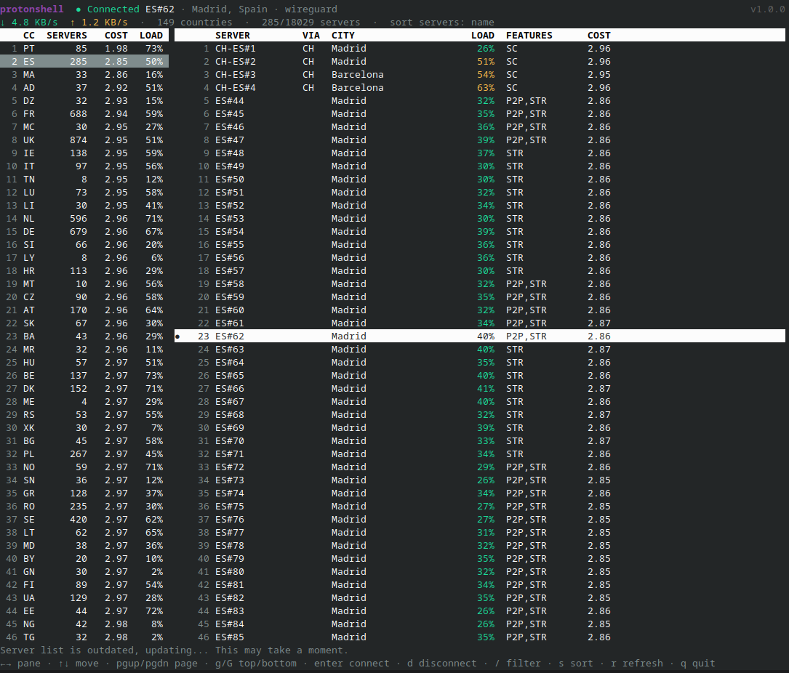

# protonshell



- [protonshell](#protonshell)
  - [Requirements](#requirements)
  - [Features](#features)
  - [Installation](#installation)
    - [Binary](#binary)
    - [Go](#go)
  - [Usage](#usage)
  - [CLI Flags](#cli-flags)
  - [Keys](#keys)
  - [Columns](#columns)
  - [Local Development](#local-development)
  - [License](#license)

A terminal UI for browsing and connecting to Proton VPN servers.

> [!IMPORTANT]
> **protonshell is a front end for the official [Proton VPN CLI](https://github.com/ProtonVPN/proton-vpn-cli), not a VPN client.**
> It does not connect to Proton by itself: every connect, disconnect and status check runs the `protonvpn` command, and the server list is read from the cache that CLI maintains.
> Install the Proton VPN CLI separately and sign in with it before using protonshell.
>
> This project is not affiliated with or endorsed by Proton AG.

## Requirements

- Linux
- The [Proton VPN CLI](https://github.com/ProtonVPN/proton-vpn-cli), installed separately, with `protonvpn` on your `PATH`
- A signed-in Proton VPN account:

  ```bash
  protonvpn signin
  ```

protonshell reads the server list from the CLI's cache at `~/.cache/Proton/VPN/serverlist.json`; if that file does not exist yet, protonshell will show an error until the CLI has written it.

## Features

- **Two-pane browser**: countries on the left, the selected country's servers on the right
- **Connect** to a specific server, or to the fastest server in a country (`protonvpn connect --country`)
- **Live status**: connection state, server and protocol, plus download/upload speed on the VPN interface
- **Filter** by server name, city or country code
- **Sort** each pane independently by cost, load or name
- **Live server list**: picks up changes when the CLI rewrites its cache

## Installation

Install the [Proton VPN CLI](#requirements) first.

### Binary

Linux binaries (x86_64, arm64) are available on the [releases page](https://github.com/UltimateForm/protonshell/releases/latest), as a plain executable or a `.tar.gz`.

#### 1. Download

Download the latest release for your architecture:

```bash
ARCH=$(uname -m)                      # x86_64 or aarch64
[ "$ARCH" = aarch64 ] && ARCH=arm64   # release assets name it arm64
curl -fLO "https://github.com/UltimateForm/protonshell/releases/latest/download/protonshell_Linux_${ARCH}"
```

Optionally verify it against the release checksums (replace `1.0.0` with the release you downloaded):

```bash
curl -fL "https://github.com/UltimateForm/protonshell/releases/download/v1.0.0/protonshell_1.0.0_checksums.txt" \
  | sha256sum --check --ignore-missing
```

#### 2. Install

Pick one of the two options below. To update later, repeat both steps.

**Option A: bin folder.** Install it on your `PATH` under the name `protonshell`, either for your user (no root; make sure `~/.local/bin` is on your `PATH`):

```bash
install -Dm755 "protonshell_Linux_${ARCH}" ~/.local/bin/protonshell
rm "protonshell_Linux_${ARCH}"
```

or system-wide:

```bash
sudo install -m755 "protonshell_Linux_${ARCH}" /usr/local/bin/protonshell
rm "protonshell_Linux_${ARCH}"
```

**Option B: shell alias.** Keep the binary wherever you like, without touching your `PATH`:

```bash
mkdir -p ~/apps
mv "protonshell_Linux_${ARCH}" ~/apps/protonshell
chmod +x ~/apps/protonshell
```

Then alias it in `~/.bashrc` or `~/.zshrc`:

```bash
# feel free to name it anything else, and add default flags here
alias protonshell="$HOME/apps/protonshell"
```

and reload your shell:

```bash
source ~/.bashrc  # or ~/.zshrc
```

Either way, run it with `protonshell`.

### Go

```bash
go install github.com/UltimateForm/protonshell@latest
```

Or build from source:

```bash
git clone https://github.com/UltimateForm/protonshell.git
cd protonshell
make install   # installs to ~/.local/bin; override with PREFIX=/usr/local
```

## Usage

```bash
protonshell
```

## CLI Flags

```
  -iface string
    	VPN network interface to measure speed on (default "proton0")
  -list string
    	path to the Proton VPN server list cache (default "~/.cache/Proton/VPN/serverlist.json")
```

## Keys

| Key | Action |
|-----|--------|
| `←` / `h`, `→` / `l` | Switch between country and server panes |
| `↑` / `k`, `↓` / `j` | Move cursor |
| `Page Up` / `Page Down` | Move one page |
| `g` / `Home`, `G` / `End` | Jump to top / bottom |
| `Enter` | Connect: fastest server in the country (country pane) or the selected server (server pane) |
| `d` | Disconnect |
| `/` | Filter; `Enter` keeps the filter, `Esc` clears it |
| `s` | Cycle the focused pane's sort |
| `r` | Refresh connection status |
| `q` / `Ctrl+C` | Quit |

## Columns

| Column | Meaning |
|--------|---------|
| `COST` | Proton's server score: lower is better. It is computed by Proton's API and appears to depend mostly on your location; it is what the CLI's "fastest server" picks. In the country pane it is the lowest cost of that country's servers. |
| `LOAD` | Server load. In the country pane it is the average across that country's servers. |
| `VIA` | Entry country, for Secure Core servers that route through another country. |
| `FEATURES` | `SC` Secure Core, `P2P`, `STR` streaming, `TOR`, `FREE` free tier. |

## Local Development

Prerequisites: Go (version in `go.mod`), Make, and the Proton VPN CLI for running the app.

```bash
make run     # build into .out/ and run; pass flags with ARGS="-iface wg0"
make check   # gofmt check, go vet, tests
make help    # list all targets
```

## License

This project is licensed under the **GNU Affero General Public License v3.0 (AGPL-3.0)**. See [LICENSE](LICENSE) for details.
